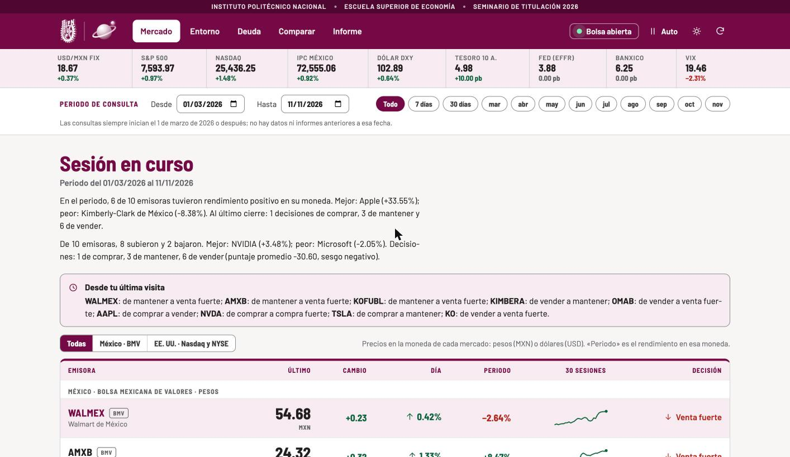
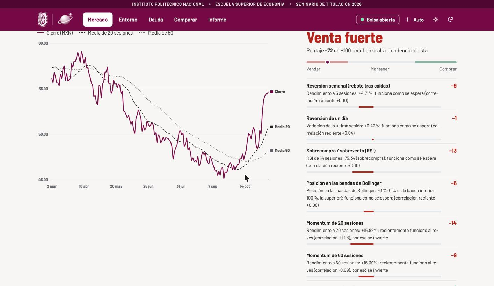
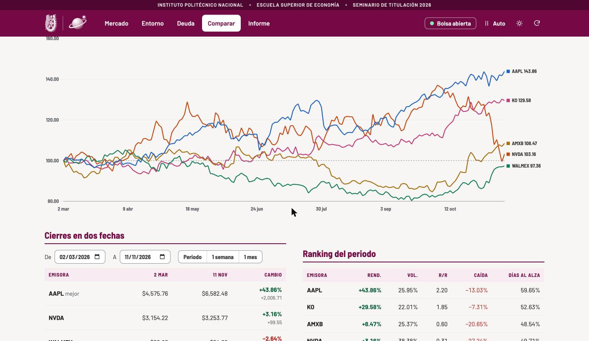
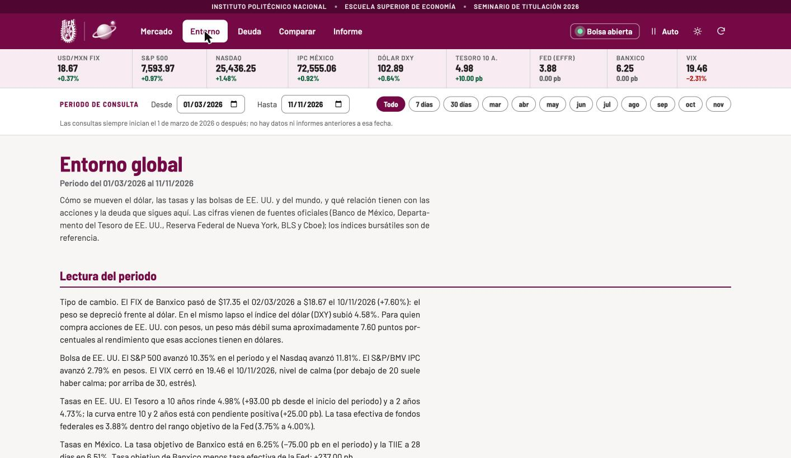

# Alzea: mercados, deuda y entorno global

Aplicación web que sigue 10 acciones (BMV, Nasdaq y NYSE) y 7 instrumentos de deuda mexicanos. Muestra precio, estadística de riesgo, proyecciones y una decisión explicada, con fuentes oficiales para el entorno global. Es el proyecto del Seminario de Titulación 2026 de la Escuela Superior de Economía del IPN.

App en línea: https://monitor-mercado-alpha.vercel.app

Es una herramienta educativa. Las decisiones que muestra no son asesoría financiera.



## Qué incluye

Cinco secciones, con consulta por periodo (siempre desde el 1 de marzo de 2026) o por día:

- **Mercado:** cotizaciones por bolsa y, al elegir una emisora, su gráfica con medias móviles y bandas de Bollinger, la decisión con cada señal que la explica, estadística de riesgo, proyección de precio y relación con el S&P 500 y el dólar.
- **Entorno:** dólar FIX, bolsas del mundo, tasas de México y de Estados Unidos, inflación, VIX y diferenciales, con la fuente de cada cifra.
- **Deuda:** rendimiento por subasta, qué es cada instrumento, proyección de la siguiente tasa y sensibilidad del precio a las tasas.
- **Comparar:** rendimiento base 100, ranking, correlaciones, portafolio equiponderado contra uno de mínima varianza y una simulación.
- **Informe:** PDF y Excel del periodo o de cualquier día, generados al momento con los datos más recientes.

También funciona sin internet: guarda en el dispositivo las pantallas y cada consulta, y avisa cuando muestra datos guardados.



## Cómo se toma una decisión

Cada emisora recibe nueve señales técnicas (reversión de uno y de cinco días, RSI, bandas de Bollinger, momentum de 20, 60 y 120 sesiones, tendencia frente a la media de 50 sesiones y MACD). El peso de cada señal se recalcula todos los días con la correlación que tuvo en las últimas 250 sesiones frente al rendimiento a cinco sesiones. Solo usa resultados que ya se conocían ese día, y si una señal funcionó al revés, se invierte.

El puntaje va de menos 100 a 100. Desde 20 la decisión es comprar y desde menos 20 es vender, y las señales fuertes empiezan en 45 y menos 45. Entre menos 20 y 20 se mantiene. El detalle está en [docs/metodologia.md](docs/metodologia.md).

## Qué dice la medición

El modelo se evalúa día por día, sin ver el futuro: una decisión de comprar acierta si el precio sube en cinco sesiones, una de vender si baja, y mantener si el precio se mueve 2% o menos. El acierto total ronda el 50%. La ventaja sobre el azar es pequeña y la sección Informe muestra la cifra al día, desglosada por tipo de decisión. El valor del modelo está en que cada decisión se puede explicar y verificar, no en que prometa rendimientos.

## Límites

- Las decisiones son técnicas y de corto plazo. No consideran los fundamentos de la empresa ni el perfil de quien consulta.
- Los precios de acciones e índices vienen de Yahoo Finance, que es una fuente de referencia y puede tener un retraso de 15 a 20 minutos.
- Las consultas empiezan el 1 de marzo de 2026, así que la medición de aciertos cubre pocos meses y su cifra puede cambiar bastante de un mes a otro.
- Las proyecciones son rangos estadísticos, no pronósticos. El precio real puede quedar fuera de ellos, y la app muestra cuántas veces lo hizo en el pasado.



## Entorno global y fuentes



Fuentes oficiales: Banco de México (SIE), Departamento del Tesoro de Estados Unidos, Reserva Federal de Nueva York, BLS y Cboe. Las fichas de cada empresa salen de SEC EDGAR y de la BMV. Los precios de acciones e índices son de referencia (Yahoo Finance).

## Cómo correrla en local

Se probó con Python 3.14. La acción de GitHub usa Python 3.12.

```bash
git clone https://github.com/EdwinACM/monitor-mercado.git
cd monitor-mercado
python3 -m venv .venv
source .venv/bin/activate
pip install -r requirements.txt
python server.py
```

La app queda en http://localhost:8765. En Mac, `iniciar.command` hace lo mismo con doble clic.

## Pruebas

Los cálculos de indicadores, decisión, resumen del mercado, proyecciones, portafolio y duración tienen pruebas que no necesitan internet. Una acción de GitHub las corre en cada cambio a `main` y en cada pull request.

```bash
pip install -r requirements-dev.txt
python -m pytest
```

## Cómo está organizado

- `server.py` consulta las fuentes y atiende las rutas `/api/*`.
- `analisis.py` calcula indicadores, estadística, decisiones, comparación, deuda y simulación.
- `modelo.py` ajusta los pesos diarios del modelo de decisión con validación hacia adelante.
- `proyeccion.py` calcula proyecciones, Sharpe, Sortino, CAPM, portafolio y duración.
- `contexto.py`, `fuentes.py` y `glosario.py` arman el entorno global y explican cada medida.
- `fichas.py` y `actualizar_fichas.py` traen datos reales de cada empresa con su fuente.
- `reportes.py` y `excel.py` generan los PDF y los Excel. `ejercicio.py` genera el ejercicio de rendimientos del seminario.
- `diario.py` y `analisis_diario.py` guardan el análisis de cada día en `static/data/`.
- `api/index.py` es la única función de Vercel.
- `static/` tiene la interfaz, el modo sin internet, las tipografías y los datos guardados.
- `tests/` tiene las pruebas, `docs/` la metodología y las capturas, y `LICENSE` la licencia.

## Despliegue y análisis diario

Está alojada en Vercel (plan gratuito) y cada cambio a la rama `main` la publica de nuevo en uno o dos minutos. Una acción de GitHub (`.github/workflows/analisis-diario.yml`) genera el análisis cada día hábil a las 16:00 hora de la Ciudad de México y guarda los archivos en `static/data/`.

## Seguridad

La app solo muestra datos públicos y no tiene cuentas de usuario. Valida todo parámetro (fechas y claves de emisoras), consulta únicamente servidores fijos, no expone detalles internos en los errores y envía las cabeceras Content-Security-Policy, X-Frame-Options, nosniff y Referrer-Policy.

## Licencia y créditos

El código se publica con licencia MIT (archivo `LICENSE`; el detalle de lo que no cubre está en `NOTICE.md`). La licencia no cubre el escudo del IPN ni el de la ESE, ni los logotipos de `static/marca/`, que pertenecen a sus instituciones. Los archivos de terceros conservan su licencia: las tipografías Barlow (SIL Open Font License 1.1, texto en `static/marca/OFL-BarlowSemiCondensed.txt`) y la librería Chart.js (MIT).

## Avisos

Las decisiones, proyecciones y simulaciones son material educativo. No sustituyen la asesoría de un profesional ni constituyen una recomendación de inversión. El escudo del IPN y el de la ESE son de sus instituciones.
